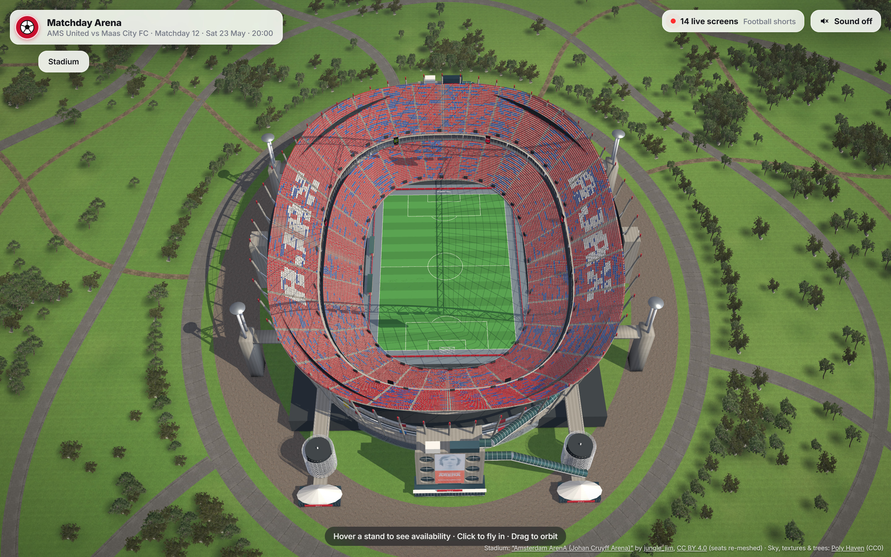
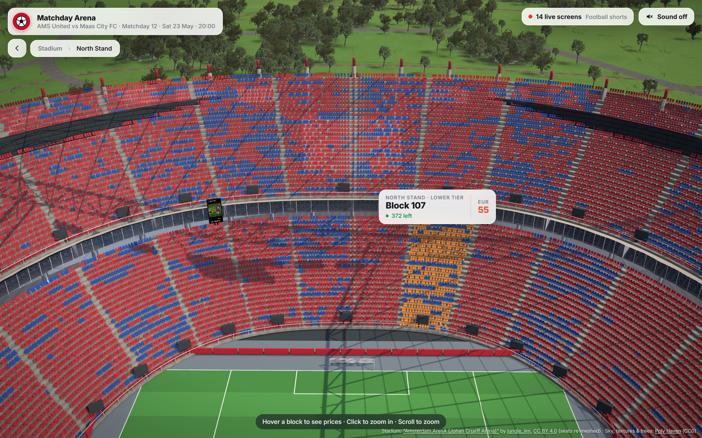
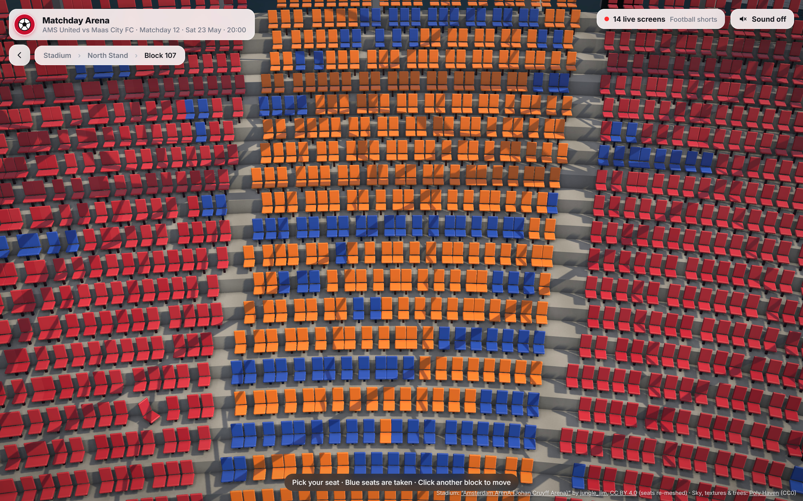
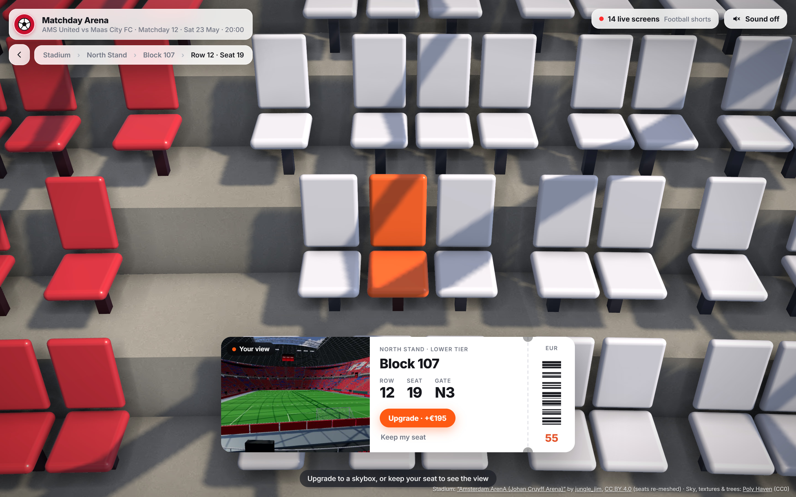
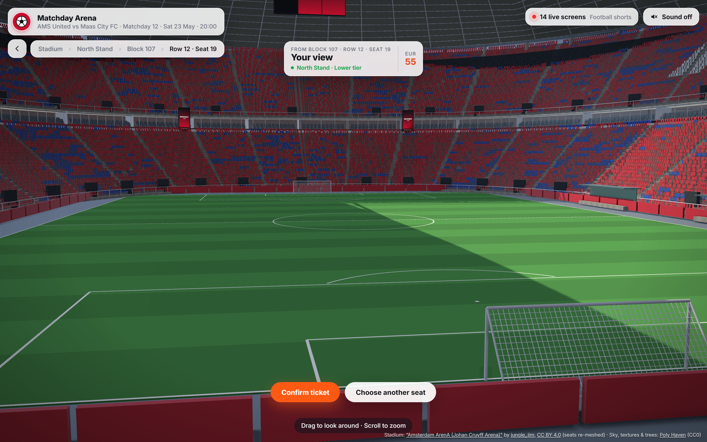
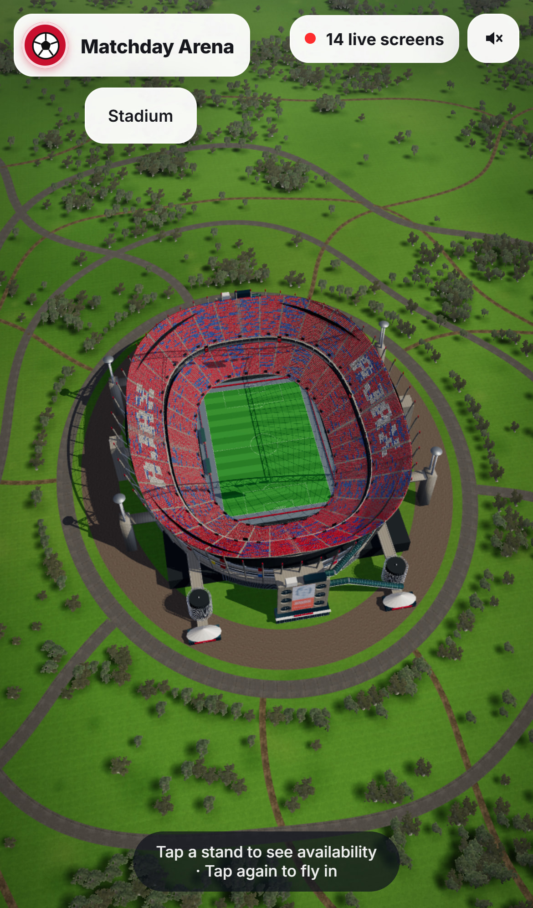
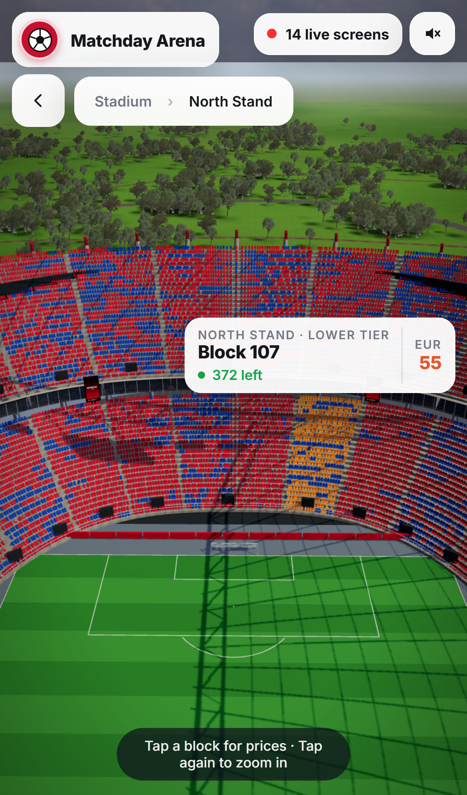
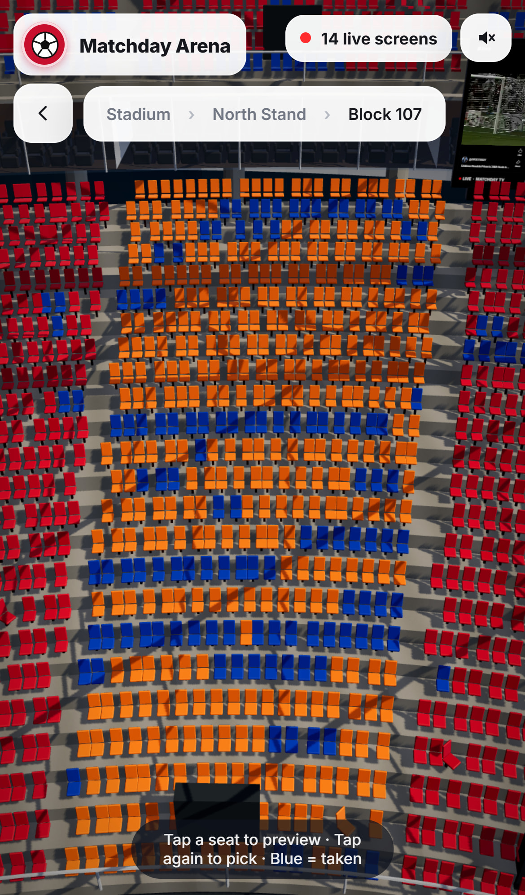
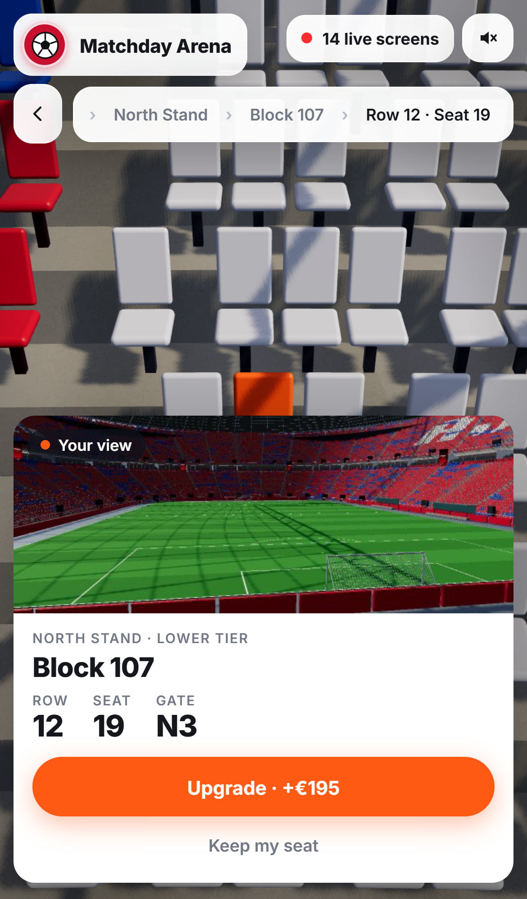
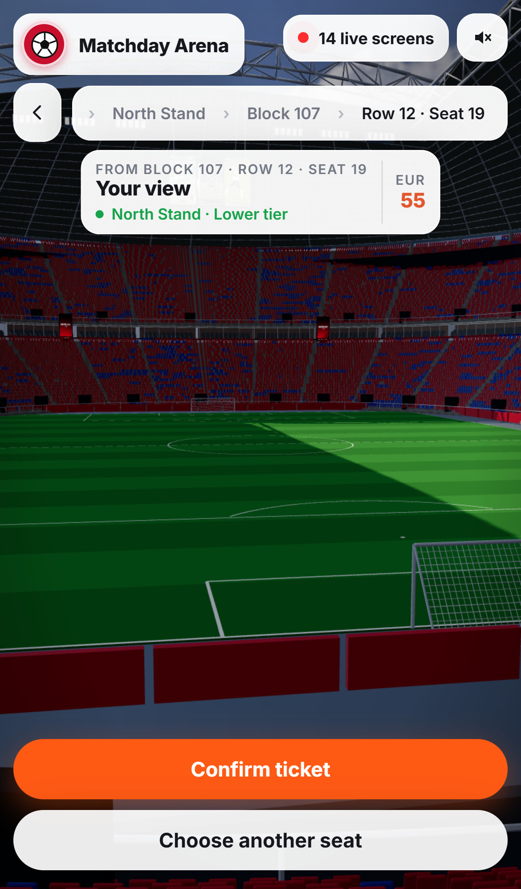

# 🏟️ Matchday Arena 3D — Fullstack Stadium Seat-Picker

[](https://nodejs.org/)
[](https://threejs.org/)
[](https://expressjs.com/)
[](https://github.com/)
[](LICENSE)

> **A cutting-edge, broadcast-grade 3D football stadium web application featuring a smooth interactive seat-picker, first-person eye-level sightline preview, dual-device views (Laptop & Phone), procedural Web Audio crowd synthesizer, and a production-ready secure Node.js backend with cryptographic ticket verification.**

---

## 📌 GitHub About / Repository Snippet

- **Short Description**:  
  `A fully 3D interactive football stadium seat-picker with eye-level sightline previews, dual device views (Laptop/Phone), Web Audio ambiance, and HMAC-SHA256 secured ticketing backend.`
- **Repository Topics / Tags**:  
  `threejs`, `webgl`, `stadium`, `seat-picker`, `football`, `soccer`, `fullstack`, `express`, `security`, `crypto`, `hmac-sha256`, `web-audio-api`, `interactive-3d`, `responsive`

---

## 📱 Visual Showcase & Device Previews

### 💻 Laptop Experience (16:9 Widescreen)

| 01. Aerial Orbit | 02. Stand View | 03. Block View |
|:---:|:---:|:---:|
|  |  |  |

| 04. Seat Chosen & Ticket Card | 05. View From Seat (POV) |
|:---:|:---:|
|  |  |

---

### 📱 Mobile Experience (Portrait Phone View)

| 01. Aerial | 02. Stand | 03. Block | 04. Seat Ticket | 05. View From Seat |
|:---:|:---:|:---:|:---:|:---:|
|  |  |  |  |  |

---

## 🌟 Key Features

### 1. 🌐 Dual-Engine Experience
- **📸 HD Photoreal Flow**: Experience the authentic visual tour across all 5 stages using the high-fidelity render assets for both Laptop and Mobile.
- **🎮 Realtime 3D WebGL Engine**: Full Three.js 3D stadium bowl with GPU instanced seating (50,000+ seats), cantilevered roof trusses casting real-time shadows, floodlight towers, pitch grass mow stripes, and hanging jumbotrons.
- **📱 Instant Device Toggle**: One-click toggle between **Laptop (Desktop)** and **Phone (Mobile)** layouts.

### 2. 🎬 5-Stage Interactive Journey
1. **Aerial Orbit View**: Fly over the arena and surrounding park. Hovering or tapping a stand illuminates an availability chip (`East Stand • 8,935 left • from €45`).
2. **Stand View**: Zoom into the chosen grandstand (North, South, East, West) with tier details and block availability.
3. **Block Close-up**: High-detail seating terrace view. Blue seats are taken; free red seats can be selected.
4. **Seat Selection & Ticket Drawer**: Chosen seat glows in radiant amber gold. Slide-up ticket drawer provides fixture info, pricing, live sightline snapshot, and upgrade options.
5. **View From Seat (360° POV)**: First-person eye-level human perspective of the pitch under the stadium canopy with full look-around capability.

### 3. 🔒 Production Security Architecture
- **🛡️ Helmet Security Headers**: Strict Content Security Policy (CSP), anti-clickjacking frameguard, X-Content-Type-Options, XSS protection.
- **🚦 Anti-Scalping Rate Limiting**: Velocity limiting on booking and reservation endpoints preventing bot scraping and ticket scalping.
- **⚡ Anti-Double-Booking / Mutex Concurrency Lock**: In-memory atomic reservation lock holding seats for 5 minutes during checkout to eliminate race conditions.
- **🔑 HMAC-SHA256 Cryptographic Ticket Verification**: Every booked pass receives a digitally signed HMAC-SHA256 signature token. Any modification to ticket data immediately triggers signature invalidation.
- **🚧 Turnstile Gate Admission Simulator**: Real-time turnstile barrier simulation verifying the digital signature before opening stadium gates.
- **🧼 Input Sanitization**: Strict regex validation on seat IDs, attendee names, and email schemas.

### 4. 🔊 Procedural Web Audio Engine
- Synthesizes realistic stadium crowd roar, low-frequency acoustic drone, and periodic cheer swells via Web Audio API.
- Authentic referee whistle acoustics with 35Hz flutter.
- Interactive Sound ON/OFF control with zero external MP3 dependencies.

---

## 🛠️ Tech Stack

| Layer | Technologies |
|---|---|
| **Frontend** | HTML5, CSS3 (Glassmorphism, Dark Futuristic Luxury), Modern ES Modules |
| **3D & Graphics** | Three.js (r170), WebGL, InstancedMesh, ACESFilmic Tone Mapping |
| **Audio** | Web Audio API (Procedural Crowd & Whistle Synthesizer) |
| **Backend** | Node.js (v24+), Express.js |
| **Security** | Helmet (CSP), Express Rate Limit, Node.js Crypto (HMAC-SHA256) |
| **Assets** | High-Resolution Laptop & Mobile Showcase Assets |

---

## 🚀 Quick Start

### 1. Clone & Install
```bash
git clone <your-repo-url>
cd "3D Stadium"
npm install
```

### 2. Run Automated Security & Integrity Tests
```bash
npm test
```
*Executes input sanitization tests, schema validation, HMAC-SHA256 digital signature checks, and anti-double-booking concurrency lock tests.*

### 3. Start the Server
```bash
npm start
```

### 4. Open Application
Navigate to [http://localhost:3000](http://localhost:3000) in your browser.

---

## 📡 REST API Documentation

| Method | Endpoint | Description | Security |
|---|---|---|---|
| `GET` | `/api/health` | Health & security status | Rate limited |
| `GET` | `/api/stadium/fixture` | Match fixture & team metadata | Rate limited |
| `GET` | `/api/stadium/stands` | Stand configurations & live availability | Rate limited |
| `GET` | `/api/stadium/blocks/:blockId/seats` | Real-time seat statuses for a block | Input sanitized, Rate limited |
| `POST` | `/api/tickets/reserve` | 5-minute atomic seat lock | Strict rate limiter, Schema check |
| `POST` | `/api/tickets/book` | Checkout & cryptographic ticket issuance | HMAC-SHA256 signed, Rate limited |
| `GET` | `/api/tickets/verify/:ticketId` | Turnstile gate admission scanner | Cryptographic signature validation |

---

## 📜 License

This project is licensed under the MIT License — see the [LICENSE](LICENSE) file for details.
